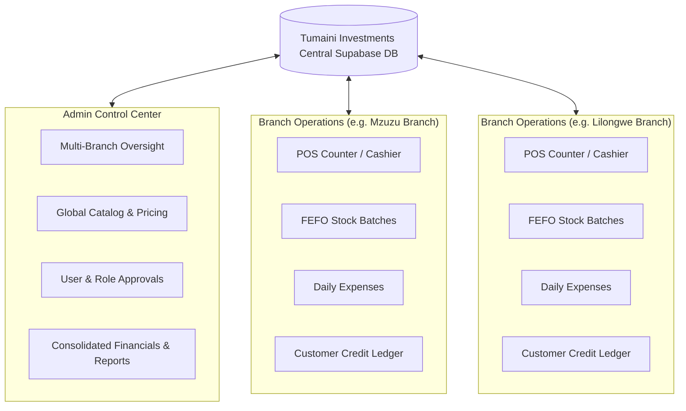
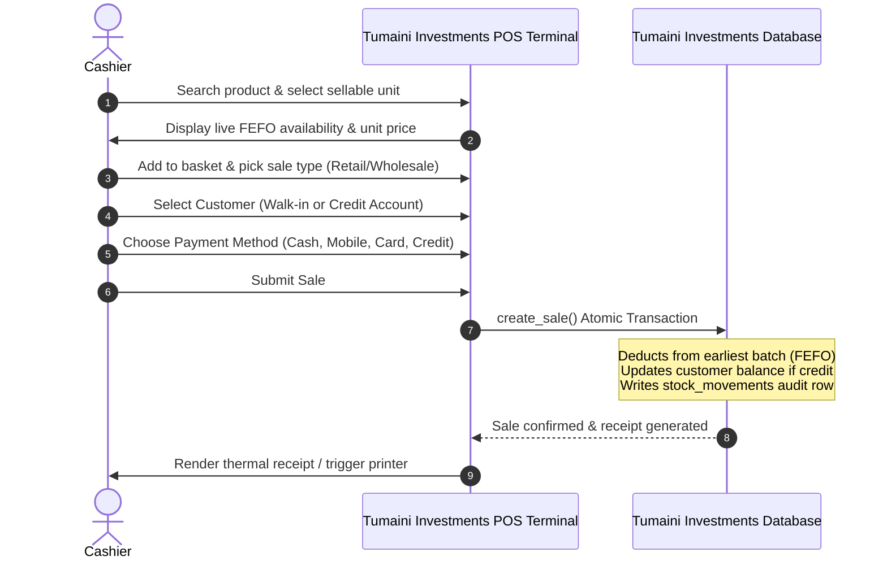
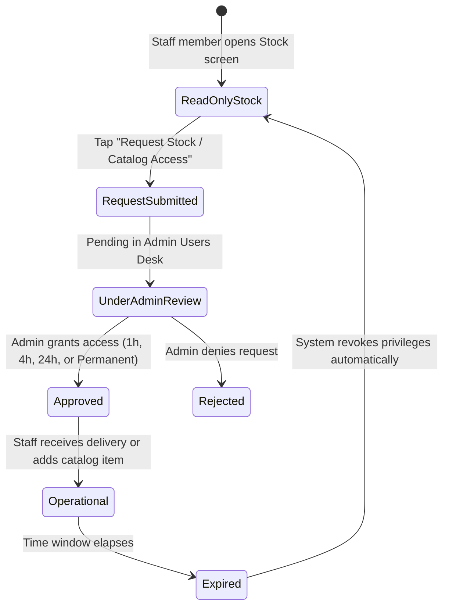
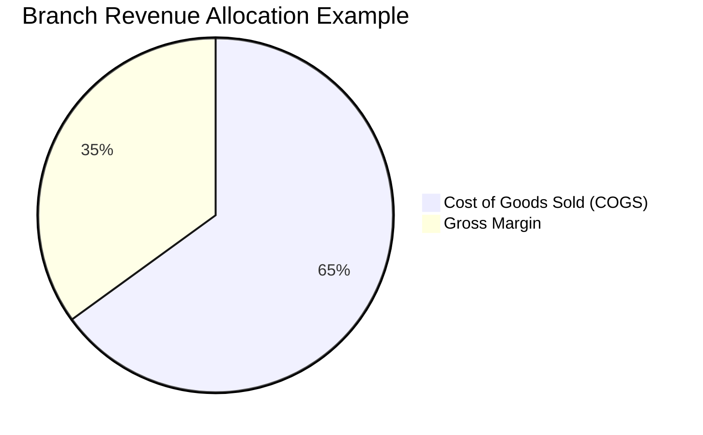

# Tumaini Investments — Comprehensive User Manual & Operations Guide

> **System Version:** 1.0.0  
> **Platform Support:** Desktop (macOS, Windows, Linux), Mobile (Android, iOS), Web  
> **Base Currency:** Malawian Kwacha (MK)  
> **Target Audience:** Store Owners, System Administrators, Branch Managers, Cashiers, and Stock Controllers

---

## Table of Contents
1. [Introduction to Tumaini Investments](#1-introduction-to-tumaini-investments)
2. [User Roles & Security Architecture](#2-user-roles--security-architecture)
3. [Account Setup & Getting Started](#3-account-setup--getting-started)
4. [Point of Sale (POS) & Counter Operations](#4-point-of-sale-pos--counter-operations)
5. [Inventory, Batches & FEFO Management](#5-inventory-batches--fefo-management)
6. [Access Requests & Security Approvals](#6-access-requests--security-approvals)
7. [Branch Expenses & Petty Cash](#7-branch-expenses--petty-cash)
8. [Administrator Control Center](#8-administrator-control-center)
9. [Financial Reports, Ledgers & Debt Tracking](#9-financial-reports-ledgers--debt-tracking)
10. [Hardware, Receipt Printing & Preferences](#10-hardware-receipt-printing--preferences)
11. [Troubleshooting & Frequently Asked Questions](#11-troubleshooting--frequently-asked-questions)

---

## 1. Introduction to Tumaini Investments

**Tumaini Investments** is an enterprise-grade Pharmacy and Retail Point of Sale (POS), Inventory Control, and Financial Ledger system. It is engineered specifically for multi-branch environments where accurate batch tracking, expiry monitoring, strict cash-drawer control, and audit compliance are vital.

### Core Architecture Highlights

* **First-Expired, First-Out (FEFO) Automation:** Tumaini Investments prevents dispensing expired items by default. The system automatically prioritizes stock batches with the earliest expiry dates during counter sales.
* **Multi-Unit Inventory & Sales:** Stock can be tracked and sold flexibly across multiple packaging sizes (e.g., individual tablets, blister strips, or complete 100-count boxes).
* **Immutable Audit Ledger:** Every stock intake, sale, refund, or adjustment is permanently registered with a traceable movement record and the identity of the staff member responsible.
* **Double-Entry Financial Triggers:** Customer credit debts and supplier balances are maintained automatically via database triggers, eliminating manual record sync discrepancies.
* **Adaptive Multi-Platform Interface:** Fully responsive UI featuring a fixed navigation rail for desktop workstations and a streamlined floating navigation bar for mobile devices.

---

## 2. User Roles & Security Architecture

Access in Tumaini Investments is governed by strict Role-Based Access Control (RBAC).

| Capability | Administrator (`admin`) | Branch Manager (`manager`) | Cashier (`cashier`) | Stock Controller (`stock_controller`) |
| :--- | :---: | :---: | :---: | :---: |
| **Branch Scope** | All Branches | Assigned Branch | Assigned Branch | Assigned Branch |
| **Make Sales & Print Receipts** | Yes (Can choose branch) | Yes | Yes | Read-Only |
| **Record Branch Expenses** | Yes | Yes | Yes | No |
| **View Daily Shift Summary** | Yes | Yes | Yes | Yes |
| **Receive Stock Deliveries** | Yes | With Access Grant | With Access Grant | With Access Grant |
| **Add New Catalog Products** | Yes | With Access Grant | With Access Grant | With Access Grant |
| **Manage Users & Branches** | Yes | No | No | No |
| **Convert Units in Bulk** | Yes | No | No | No |
| **View Profit Margins & COGS**| Yes | No | No | No |
| **Export Full Audits (CSV/PDF)**| Yes | No | No | No |

---

## 3. Account Setup & Getting Started

### 3.1 Staff Registration
1. Launch **Tumaini Investments** on the workstation or mobile tablet.
2. On the login screen, click **Set up staff access**.
3. Fill in the required details:
   * **Full Name:** Official employee name.
   * **Username:** Unique system handle (letters, numbers, and underscores).
   * **Email Address:** Valid company or work email.
   * **Password:** At least 6 characters.
4. Click **Create account**.

> [!IMPORTANT]
> Newly created accounts are placed in a **Pending Approval** state by default with no branch assigned. The employee will not be able to log in until an Administrator approves the account, assigns an operational branch, and designates a role.

### 3.2 Logging In
1. Enter your registered email address and password.
2. Click **Sign in**.
3. The system directs users automatically based on assigned roles:
   * **Administrators** are routed to the **Admin Business Overview**.
   * **Managers, Cashiers, and Stock Controllers** are routed to their assigned **Branch Home**.

### 3.3 Password Recovery
If credentials are forgotten:
1. Click **Forgot password?** on the sign-in screen.
2. Enter the registered account email.
3. Check the inbox for a secure password reset link to create a new password.

---

## 4. Point of Sale (POS) & Counter Operations

The POS screen (`Sale` tab) allows fast, reliable counter checkout in five simple steps.

### 4.1 Step 1: Locating Products
* **Search Bar:** Type drug or product names. Results filter instantaneously.
* **Category Filter:** Filter by department (e.g., *Antibiotics*, *Analgesics*, *Supplies*).
* **Availability Indicator:** Items with zero sellable stock are disabled and greyed out to prevent accidental overselling.

### 4.2 Step 2: Multi-Unit Selection & Cart Management
* If a product has multiple packaging formats configured (e.g., *Tablets* and *Boxes*):
  1. Click the unit pill dropdown next to the item name.
  2. Select the desired selling unit.
  3. The system automatically recalculates the unit price and updates the quantity stepper intervals.
* Increment or decrement quantities using the `+` / `-` buttons, or type the exact quantity directly into the input box.
* Tumaini Investments enforces availability constraints in real time; cashiers cannot add more units than are physically available in active, unexpired batches.

### 4.3 Step 3: Retail vs. Wholesale Pricing
* Toggle between **Retail** and **Wholesale** at the top of the transaction summary.
* Selecting Wholesale instantly reapplies wholesale tier pricing across all eligible items in the basket.

### 4.4 Step 4: Customer Assignment
* **Walk-In Customers (Cash/Mobile/Card):** Customer selection is optional.
* **Credit / Debt Sales:** Selecting an existing registered customer (or creating one on the spot via **+ Add Customer**) is mandatory so debts can be tracked.

### 4.5 Step 5: Payment Processing
Tumaini Investments supports five payment workflows:
1. **Cash:** Enter the cash tendered by the customer. Tumaini Investments calculates and displays the exact change due.
2. **Airtel Money:** Customer transfers funds via Airtel Money. Cashier verifies the transaction confirmation code and selects Airtel Money.
3. **TNM Mpamba:** Customer transfers funds via TNM Mpamba. Cashier confirms receipt and selects TNM Mpamba.
4. **Card:** Customer pays via POS card terminal.
5. **Credit (Debt):**
   * Requires a selected customer.
   * Cashier can record an optional **Part-payment deposit** paid upfront.
   * Any remaining unpaid balance is posted directly to the customer's ledger balance automatically.

### 4.6 Receipt Issuance & Reprints
* Following transaction completion, the PDF receipt renders instantly on screen.
* Options include:
  * **Print:** Sends raw format to connected thermal printers or system dialogs.
  * **Share:** Exports PDF via system share sheet or messaging apps.
  * **New Sale:** Clears cart state for the next customer.
* **Reprinting Past Sales:** Tap **Today's Sales** at the top right of the POS screen, select any previous receipt number, and view or reprint the original document.

---

## 5. Inventory, Batches & FEFO Management

Unlike generic retail software that groups all inventory into a single count, Tumaini Investments tracks stock at the individual **Batch** level.

### 5.1 Why Batch Tracking Matters
In healthcare and pharmaceutical retail, two deliveries of the same drug often arrive with different buying costs and different expiry dates:
* **Batch A:** Expiry March 2027, Buying Price MK 150
* **Batch B:** Expiry October 2028, Buying Price MK 180

Tumaini Investments maintains these as separate inventory records. When a cashier sells the drug:
1. The system automatically depletes **Batch A** first.
2. Only after Batch A is exhausted does it draw from Batch B.
3. Batches that have reached or passed today's date are excluded from sellable stock.

### 5.2 Stock Health Indicators
* **Current Stock (`v_current_stock`):** Total active physical inventory across all unexpired batches.
* **Low Stock Warning (`v_low_stock`):** Displayed when total available units fall below the preset `reorder_level`.
* **Expiring Soon (`v_expiring_soon`):** Proactive warnings for any batch expiring within **90 days**, allowing managers to apply discounts or return products before expiry.

### 5.3 Receiving Stock Deliveries
Staff with approved stock access can log new deliveries:
1. Navigate to the **Stock** tab and select **Receive Delivery**.
2. Select the catalog item from the search list.
3. Input delivery specifications:
   * **Batch Number:** Manufacturer batch code printed on the packaging.
   * **Expiry Date:** Exact batch expiration date.
   * **Quantity Received:** Count of units received.
   * **Buying Price:** Unit cost per base unit from the invoice.
   * **Retail Selling Price:** Price charged to counter customers.
   * **Wholesale Selling Price:** Discounted bulk purchase price.
   * **Supplier & Invoice Number:** Linked supplier account and invoice reference.
4. Click **Confirm Intake**.
5. The system records the batch in `inventory`, adds the purchase line in `purchases`, and logs an opening `purchase_in` in `stock_movements`.

---

## 6. Access Requests & Security Approvals

To maintain administrative integrity without bottlenecking daily store operations, Tumaini Investments utilizes a temporary **Privilege Escalation Workflow**.

### 6.1 Submitting an Access Request (Staff)
1. Go to the **Stock** tab.
2. If access has not been granted, tap **Request Access to Receive Stock** or **Request Access to Add Products**.
3. Enter a brief justification (e.g., *"Receiving afternoon delivery from MedPharm Distributors"*).
4. Tap **Submit Request**.

### 6.2 Reviewing & Approving Requests (Administrator)
1. In the Admin Shell, navigate to **Users** (or click the alert banner on **Home**).
2. Switch to the **Stock Access** or **Catalog Access** section.
3. Review pending requests showing staff name, branch, timestamp, and reason.
4. Click **Approve** and choose an operational duration:
   * **1 Hour:** Best for immediate deliveries.
   * **4 Hours:** Suitable for full morning stock intake.
   * **24 Hours:** For full-day inventory audits.
   * **Permanent:** For senior supervisors or trusted inventory heads.
5. Or click **Reject** with an explanation.

---

## 7. Branch Expenses & Petty Cash

Accurate net profit calculations require recording all operational store overheads alongside daily revenues.

### 7.1 Recording an Expense
1. From the **Branch Home** screen, tap **New Expense** (or the **Expenses** tab on desktop).
2. Fill in the expense modal:
   * **Category:** Choose from *Transport, Electricity, Rent, Salaries, Airtime & Internet, Repairs,* or *Other*.
   * **Amount (MK):** Expense value in Kwacha.
   * **Description / Purpose:** Specific detail (e.g., *"ESCOM prepaid electricity units token"*).
   * **Date:** Defaults to today.
3. Tap **Save Expense**.

### 7.2 Cash Drawer Impact
Expenses recorded by staff are deducted from the store's gross profit calculations and reflected in end-of-shift cash drawer reconciliations.

---

## 8. Administrator Control Center

Administrators have access to global management screens via the **Admin Shell**.

### 8.1 Business Overview Dashboard
* **Total Sales Today:** Aggregate revenue across all stores with transaction counts.
* **Credit Sales Today:** Total value of merchandise issued on debt.
* **Expenses Today:** Total petty cash spent across branches.
* **Branch Breakdown:** Visual comparison bars showing performance by location.
* **Needs Attention Queue:** Consolidated list of urgent items (low stock and expiring drugs across all stores).
* **Branch Filter:** Filter metrics by a single branch or view all branches combined.

### 8.2 Branch Management (`Branches` Screen)
* **Create New Branch:** Set store name, physical address/location, and phone number.
* **Edit Details:** Update branch contact information.
* **Deactivate Branch:** Temporarily hides the branch from POS and active filters without deleting historic transaction records.
* **Delete Branch:** Permanently deletes empty branches. (Branches with recorded sales or stock cannot be deleted, preserving audit history).

### 8.3 User Management (`Users` Screen)
* **Approve Pending Accounts:** Review incoming employee registrations, assign a branch, and assign a role (`cashier`, `manager`, `stock_controller`, or `admin`).
* **Reassign Roles / Transfers:** Move an employee to a different branch or change their permissions.
* **Revoke / Deactivate:** Disable staff accounts immediately upon employee departure.

### 8.4 Catalog & Unit Conversion Tool (`Catalog` Tab)
* **Standardize Products:** Create universal catalog items with approved categories, units, and reorder levels.
* **Unit Conversions:** Admin tool (`admin_convert_item_unit`) allowing units to be converted between base counts and packaging formats without corrupting stock totals.

---

## 9. Financial Reports, Ledgers & Debt Tracking

The **Reports** module provides data-driven reporting calculated directly from raw transaction records.

### 9.1 Report Periods & Filters
Filter by **Today, Yesterday, This Week, Last 7 Days, This Month, Last 30 Days,** or a **Custom Date Range**, scoped by specific branch or company-wide.

### 9.2 Report Tabs Explained
1. **Sales Summary:**
   * Total gross revenue and transaction count.
   * Payment method breakdown: Cash, Airtel Money, TNM Mpamba, Cards, and Credit.
   * Chronological sales trend bar chart.
2. **Profit & Loss:**
   * **Gross Revenue:** Total receipts.
   * **Cost of Goods Sold (COGS):** Buying cost of items sold.
   * **Gross Profit:** Gross Revenue minus COGS.
   * **Operating Expenses:** Total categorized branch overheads.
   * **Net Profit:** Realized profit after operational expenses.
3. **Best Sellers:**
   * Top products ranked by quantity sold, gross revenue generated, net profit contributed, or transaction frequency.
4. **Expense Breakdown:**
   * Aggregated spending grouped by category with visual charts.
5. **Debts & Credit Ledger:**
   * Live list of customers with unpaid credit balances.
   * Customer debt history showing every credit sale, date, and repayment made.
   * **Record Payment:** Allows staff to log customer credit repayments against their outstanding balance.

### 9.3 Exporting Reports
* **Export PDF:** Generates formal, branded executive summary sheets for management meetings or audits.
* **Export CSV:** Exports complete spreadsheet data for external accounting tools (Excel, QuickBooks, etc.).

---

## 10. Hardware, Receipt Printing & Preferences

Tumaini Investments includes tailored peripheral and receipt configurations in the **Settings** tab.

### 10.1 Receipt Paper Formats
* **80mm Roll (Thermal POS):** Standard receipt printer format with full itemization, business header, date/time, and cashier name.
* **58mm Roll (Compact Thermal):** Condensed typography designed for mini mobile Bluetooth printers.
* **A5 Document:** Standard letter half-page layout for clinic dispensaries, wholesale invoices, and bulk accounts.

### 10.2 Workflow Automation
* **Auto-Print Receipts:** When enabled, completing a transaction triggers the print dialogue immediately without requiring a manual click.
* **Default Sale Type:** Choose whether POS defaults to **Retail** or **Wholesale** mode on launch.

---

## 11. Troubleshooting & Frequently Asked Questions

### Q1: My screen says "Account pending approval". What should I do?
> **Answer:** Your registration was successful, but security rules prevent access until an Administrator activates your account and links you to an active branch. Contact your shop owner or manager to approve you in the **Users** screen.

### Q2: Why is a product greyed out in the POS even though we have boxes on the shelf?
> **Answer:** Tumaini Investments' safety engine enforces two checks:
> 1. Available quantity in the system may be 0.
> 2. The stock batch on the system may have passed its **Expiry Date**. Expired medicines are quarantined by the system and cannot be sold. Check the **Expiry** tab in Inventory.

### Q3: A customer wants to settle their outstanding debt. How do I record this?
> **Answer:** 
> 1. Navigate to **Reports** > **Debts** (or the Customers tab).
> 2. Search for the customer's name.
> 3. Click **Record Payment**, enter the amount paid and payment method (Cash / Mobile Money), and confirm.
> 4. The customer's balance updates automatically, and a payment ledger entry is saved.

### Q4: I need to receive a delivery, but the "Receive Delivery" button is locked.
> **Answer:** Tap **Request Access** on the Stock screen. Once your Administrator approves the request from their dashboard, the receiving form will unlock immediately.

### Q5: Can I use Tumaini Investments when the internet goes down?
> **Answer:** Tumaini Investments syncs in real time with the secure cloud database to maintain multi-branch consistency and prevent duplicate batch sales. If connectivity drops, restore network access (via mobile hotspot or Wi-Fi) to resume transactions.

---

*Manual published by Jaytech Innovations for Tumaini Investments. All rights reserved.*
